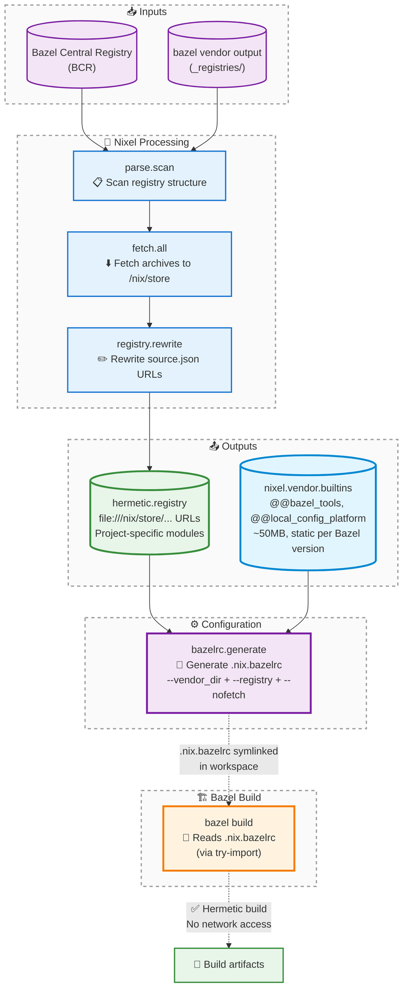

# Nixel

**Hermetic Bazel registry generation for Nix.**

Nixel transforms Bazel registries (like the Bazel Central Registry) into hermetic, offline-capable registries where all module archives are fetched into the Nix store. This enables running Bazel builds with `--nofetch` inside Nix derivations.

## Features

- **Hermetic builds**: All module sources fetched to Nix store
- **Offline-capable**: Bazel runs with `--nofetch` flag
- **Vendor support**: Process `bazel vendor` output into hermetic registries
- **Builtin repos**: Static Bazel builtins registry (version-specific)
- **Registry mirroring**: Module namespace mirrors filesystem structure
- **Integrity preserved**: All hash validation maintained
- **Single-word API**: Clean, Rust-inspired naming conventions

## Architecture

Nixel separates concerns into three layers:

1. **Builtins** (`@@bazel_tools`, `@@local_config_platform`, etc.)
   - Static per Bazel version
   - Generated once, reused across projects
   - Stored in `vendor_dir`

2. **Module registries** (rules_cc, bazel_skylib, etc.)
   - Project-specific via hermetic registry
   - Module sources fetched to `/nix/store` by Nix
   - Stored in registry format

3. **Build separation**
   - `--vendor_dir` for builtins (static, reusable)
   - `--registry` for modules (hermetic, per-project)
   - All sources from `/nix/store` (no network access)

### Architecture Diagram



**Key Data Flow:**

1. **Input**: BCR or vendor directory containing registry metadata
2. **Parse**: Scan all `source.json` files and extract module metadata
3. **Fetch**: Download each module archive to Nix store using integrity hashes
4. **Rewrite**: Create new registry with `file:///nix/store/...` URLs
5. **Output**: Hermetic registry + static builtins (shared across projects)
6. **Configuration**: Generate `.nix.bazelrc` with all required flags
7. **Build**: Bazel reads bazelrc via `try-import` for fully offline builds

## Quick Start

### Basic Usage

```nix
{
  inputs = {
    nixpkgs.url = "github:NixOS/nixpkgs/nixpkgs-unstable";
    bcr = {
      url = "github:bazelbuild/bazel-central-registry";
      flake = false;
    };
  };

  outputs = { self, nixpkgs, bcr }: {
    packages.x86_64-linux.default =
      let
        pkgs = nixpkgs.legacyPackages.x86_64-linux;
        nixel = pkgs.callPackage ./system/nixel {};

        # Create hermetic registry from BCR
        hermetic = nixel.registry.rewrite { source = bcr; };
      in
      pkgs.stdenv.mkDerivation {
        name = "my-bazel-project";
        src = ./.;

        nativeBuildInputs = [ pkgs.bazel_7 ];

        buildPhase = ''
          # Use hermetic builtins and registry with --nofetch
          bazel build \
            --vendor_dir=${nixel.vendor.builtins} \
            --registry=file://${hermetic.registry} \
            --nofetch \
            //...
        '';

        installPhase = ''
          cp -r bazel-bin $out
        '';
      };
  };
}
```

### Recommended: Bazelrc Integration

Instead of passing flags manually, generate a `.nix.bazelrc` file that Bazel automatically loads:

```nix
{
  inputs = {
    nixpkgs.url = "github:NixOS/nixpkgs/nixpkgs-unstable";
    bcr = {
      url = "github:bazelbuild/bazel-central-registry";
      flake = false;
    };
  };

  outputs = { self, nixpkgs, bcr }: {
    devShells.x86_64-linux.default =
      let
        pkgs = nixpkgs.legacyPackages.x86_64-linux;
        nixel = pkgs.callPackage ./path/to/nixel {};

        # Create hermetic registry
        hermetic = nixel.registry.rewrite { source = bcr; };

        # Generate bazelrc with all required flags
        bazelrc = nixel.bazelrc.generate {
          registries = [ hermetic.registry ];
          vendor = nixel.vendor.builtins;
        };
      in
      pkgs.mkShell {
        nativeBuildInputs = [ pkgs.bazel_7 ];

        shellHook = ''
          # Link generated bazelrc to workspace
          ln -sf ${bazelrc} .nix.bazelrc

          # Check if .bazelrc has the import
          if ! grep -q "try-import %workspace%/.nix.bazelrc" .bazelrc 2>/dev/null; then
            echo "⚠️  Add this line to your .bazelrc:"
            echo "   try-import %workspace%/.nix.bazelrc"
          else
            echo "✓ Hermetic Bazel configuration active"
          fi
        '';
      };
  };
}
```

**One-time setup**: Add to your `.bazelrc`:
```
try-import %workspace%/.nix.bazelrc
```

**Benefits**:
- No manual flag passing
- Works with `bazel`, `bazelisk`, and IDE integrations
- Automatic configuration on `nix develop`
- Clean separation of Nix-managed config

### Multiple Registries

Compose multiple registries with priority ordering:

```nix
let
  bcr = nixel.registry.rewrite { source = inputs.bcr; };
  privateModules = nixel.registry.rewrite { source = ./private-registry; };

  bazelrc = nixel.bazelrc.generate {
    registries = [
      privateModules.registry  # Highest priority
      bcr.registry             # Fallback
    ];
    vendor = nixel.vendor.builtins;
  };
in
# ... use bazelrc in shellHook
```

Bazel searches registries in order - first registry has highest priority.

### Vendor-Based Workflow

For projects with `bazel vendor` output:

```nix
let
  nixel = pkgs.callPackage ./system/nixel {};

  # Process vendor directory into hermetic registry
  hermetic = nixel.registry.vendor {
    directory = ./vendor;  # Contains _registries/ subdirectory
  };

  # Get static builtins for Bazel 7.6.0
  builtins = nixel.vendor.builtins;
in
pkgs.stdenv.mkDerivation {
  name = "bazel-with-vendor";
  src = ./.;

  nativeBuildInputs = [ pkgs.bazel_7 ];

  buildPhase = ''
    # Separate concerns: builtins + hermetic registry
    bazel build \
      --vendor_dir=${builtins} \
      --registry=file://${hermetic.registry} \
      --nofetch \
      //...
  '';
}
```

### Development Shell

The recommended approach uses bazelrc integration (see above). For reference, the equivalent without bazelrc would require aliases:

```nix
{
  devShells.default =
    let
      nixel = pkgs.callPackage ./system/nixel {};
      hermetic = nixel.registry.rewrite { source = bcr; };
      bazelrc = nixel.bazelrc.generate {
        registries = [ hermetic.registry ];
        vendor = nixel.vendor.builtins;
      };
    in
    pkgs.mkShell {
      nativeBuildInputs = [ pkgs.bazel_7 ];

      shellHook = ''
        ln -sf ${bazelrc} .nix.bazelrc
        echo "✓ Hermetic Bazel configuration linked"
        echo "  Add 'try-import %workspace%/.nix.bazelrc' to .bazelrc"
      '';
    };
}
```

## API Reference

### Public API

#### `nixel.registry.rewrite`

Create a hermetic registry from a source registry (like BCR).

**Signature:**
```nix
rewrite :: { source :: Path } -> Registry
```

**Parameters:**
- `source`: Path to a Bazel registry (local directory or flake input)

**Returns:**
```nix
{
  modules = {
    # Nested attrset mirroring registry structure
    # modules/module-name/version/ → modules.module-name.version
    module-name = {
      version = /nix/store/...-module-name-version;
    };
  };

  registry = /nix/store/...-hermetic-bazel-registry;
}
```

**Example:**
```nix
let
  hermetic = nixel.registry.rewrite { source = ./my-registry; };
in
{
  # Access specific module store path
  abseilPath = hermetic.modules.abseil-cpp."20230125.1";

  # Use registry with Bazel
  bazelFlags = "--registry=file://${hermetic.registry}";
}
```

#### `nixel.registry.minimal`

Create a registry containing only specified modules from an existing hermetic registry.

**Signature:**
```nix
minimal :: { registry :: Path, modules :: [{ name :: String, version :: String }] } -> Registry
```

**Parameters:**
- `registry`: Output from `nixel.registry.rewrite`
- `modules`: List of module specifications

**Returns:**
New `Registry` with only the specified modules.

**Example:**
```nix
let
  full = nixel.registry.rewrite { source = bcr; };

  selected = nixel.registry.minimal {
    inherit (full) registry;
    modules = [
      { name = "rules_go"; version = "0.42.0"; }
      { name = "protobuf"; version = "24.4"; }
    ];
  };
in
{
  # selected.registry contains only rules_go and protobuf
}
```

#### `nixel.registry.vendor`

Create a hermetic registry from a `bazel vendor` output directory.

**Signature:**
```nix
vendor :: { directory :: Path } -> Registry
```

**Parameters:**
- `directory`: Path to bazel vendor output (must contain `_registries/` subdirectory)

**Returns:**
`Registry` with all vendored modules hermetically fetched.

**Example:**
```nix
let
  hermetic = nixel.registry.vendor {
    directory = ./vendor;  # Contains vendor/_registries/bcr.bazel.build/
  };
in
{
  # hermetic.registry ready for Bazel
  # hermetic.modules contains all vendored modules
}
```

#### `nixel.vendor.builtins`

Static Bazel builtins registry for version 7.6.0.

**Type:**
```nix
builtins :: Path
```

**Usage:**
```nix
let
  builtins = nixel.vendor.builtins;
in
{
  # Use with --vendor_dir flag
  bazelFlags = "--vendor_dir=${builtins}";
}
```

**Note:** Builtins are Bazel-version-specific but project-agnostic. One builtins derivation can be shared across all projects using the same Bazel version.

#### `nixel.bazelrc.generate`

Generate a `.nix.bazelrc` file with hermetic Bazel configuration flags.

**Signature:**
```nix
generate :: { registries :: [Path], vendor :: Path } -> Path
```

**Parameters:**
- `registries`: List of registry paths (order matters - first has highest priority)
- `vendor`: Path to vendor directory (typically `nixel.vendor.builtins`)

**Returns:**
Path to generated `.nix.bazelrc` file containing `--vendor_dir`, `--registry`, and `--nofetch` flags.

**Example:**
```nix
let
  nixel = pkgs.callPackage ./system/nixel {};
  hermetic = nixel.registry.rewrite { source = bcr; };

  bazelrc = nixel.bazelrc.generate {
    registries = [ hermetic.registry ];
    vendor = nixel.vendor.builtins;
  };
in
pkgs.mkShell {
  shellHook = ''
    ln -sf ${bazelrc} .nix.bazelrc
  '';
}
```

**Multiple registries:**
```nix
bazelrc = nixel.bazelrc.generate {
  registries = [
    privateModules.registry  # Checked first
    bcr.registry             # Fallback
  ];
  vendor = nixel.vendor.builtins;
};
```

**Generated file format:**
```
# Generated by Nixel - hermetic Bazel configuration
# This file provides flags for fully offline, reproducible Bazel builds

build --vendor_dir=/nix/store/...-bazel-builtins
build --registry=file:///nix/store/...-hermetic-bazel-registry
build --nofetch
```

**Integration:** Add `try-import %workspace%/.nix.bazelrc` to your `.bazelrc` (one-time setup).

### Internal API

These are exposed for advanced use cases but not required for typical usage.

#### `nixel.parse`

Registry scanning and metadata parsing.

```nix
{
  # Parse source.json file
  source :: Path -> { url :: String, integrity :: String, ... } | null

  # List module names in registry
  modules :: Path -> [String]

  # List non-yanked versions for a module
  versions :: Path -> [String]

  # Scan entire registry structure
  scan :: Path -> Attrset
}
```

#### `nixel.fetch`

Module archive fetching.

```nix
{
  # Fetch single module archive to Nix store
  module :: { sourceData :: Attrset, name :: String, version :: String } -> Path

  # Fetch all modules from scanned registry
  all :: Attrset -> Attrset
}
```

## Registry Structure

Nixel preserves the Bazel registry structure while rewriting source URLs:

```
Input:
  modules/
    abseil-cpp/
      metadata.json
      20230125.1/
        source.json    # url: "https://..."
        MODULE.bazel

Output:
  modules.abseil-cpp."20230125.1" = /nix/store/...-abseil-cpp-20230125.1

  registry/
    modules/
      abseil-cpp/
        metadata.json
        20230125.1/
          source.json  # url: "file:///nix/store/..."
          MODULE.bazel
```

### Module Namespace

The `modules` attrset mirrors the registry directory structure:

```nix
{
  modules = {
    abseil-cpp."20230125.1" = storePath;
    rules_go."0.42.0" = storePath;
    protobuf."24.4" = storePath;
  };
}
```

This allows direct access: `hermetic.modules.rules_go."0.42.0"`

## How It Works

### 1. Scanning

Parse the registry structure and locate all `source.json` files:

```nix
modules/
  ├── module-a/version-1/source.json
  └── module-b/version-2/source.json
```

### 2. Fetching

For each module, fetch the archive to the Nix store using the integrity hash:

```nix
fetchurl {
  url = "https://example.com/module.tar.gz";
  hash = "sha256-...";  # From source.json
}
# → /nix/store/xyz-module-version.tar.gz
```

### 3. Rewriting

Create a new registry with `source.json` URLs rewritten to Nix store paths:

```json
{
  "url": "file:///nix/store/xyz-module-version.tar.gz",
  "integrity": "sha256-...",
  "strip_prefix": "module-version"
}
```

### 4. Using with Bazel

```bash
bazel build \
  --vendor_dir=/nix/store/xyz-bazel-builtins \
  --registry=file:///nix/store/abc-hermetic-bazel-registry \
  --nofetch \
  //...
```

Bazel uses builtins from `vendor_dir`, reads the registry for module dependencies, finds `file://` URLs, and uses local archives without network access.

## Testing

Run all integration tests via flake:

```bash
nix flake check
```

Run individual tests:

```bash
# Test registry creation
nix-build -E 'with import <nixpkgs> {}; let tests = callPackage ./system/nixel/test/integration.nix { bazel_7 = bazel_7; }; in tests.testRegistryCreated' --no-out-link

# Test source URL rewriting
nix-build -E 'with import <nixpkgs> {}; let tests = callPackage ./system/nixel/test/integration.nix { bazel_7 = bazel_7; }; in tests.testSourceRewritten' --no-out-link

# Test vendor registry processing
nix-build -E 'with import <nixpkgs> {}; let tests = callPackage ./system/nixel/test/integration.nix { bazel_7 = bazel_7; }; in tests.testVendorRegistry' --no-out-link

# Test full Bazel build with vendor
nix-build -E 'with import <nixpkgs> {}; let tests = callPackage ./system/nixel/test/integration.nix { bazel_7 = bazel_7; }; in tests.testBazelWithVendor' --no-out-link

# Test builtins reusability across projects
nix-build -E 'with import <nixpkgs> {}; let tests = callPackage ./system/nixel/test/integration.nix { bazel_7 = bazel_7; }; in tests.testBuiltinsReusable' --no-out-link
```

Test structure follows Rust conventions:
```
system/nixel/
  test.nix                    # Test entry point
  test/
    integration.nix           # Integration tests
    resource/                 # Test fixtures
      registry/minimal/       # Minimal test registry
      vendor/full/            # Full vendor example
      vendor/partial/         # Partial vendor example
      project/basic/          # Basic Bazel project
      project/complex/        # Complex Bazel project
```

## Advanced Usage

### Custom Module Selection

Process only specific modules from a registry:

```nix
let
  nixel = pkgs.callPackage ./system/nixel {};

  # Scan registry structure
  scanned = nixel.parse.scan bcr;

  # Filter to specific modules
  filtered = lib.filterAttrs (name: _:
    builtins.elem name ["rules_go" "protobuf"]
  ) scanned;

  # Fetch only filtered modules
  fetched = nixel.fetch.all filtered;
in
{
  # Build custom registry with fetched modules
  # (requires manual registry construction)
}
```

### Inspecting Module Metadata

```nix
let
  hermetic = nixel.registry.rewrite { source = bcr; };

  # Check if a specific module/version exists
  hasRulesGo = hermetic.modules ? rules_go."0.42.0";

  # Get all versions of a module
  rulesGoVersions = builtins.attrNames hermetic.modules.rules_go;
in
{
  inherit hasRulesGo rulesGoVersions;
}
```

### Parsing Source Metadata

```nix
let
  # Parse a specific source.json file
  sourceData = nixel.parse.source ./modules/rules_go/0.42.0/source.json;

  # sourceData = { url = "..."; integrity = "sha256-..."; strip_prefix = "..."; }
in
{
  inherit sourceData;
}
```

## Troubleshooting

### "integrity hash mismatch"

The source.json integrity hash doesn't match the fetched archive. This usually means:
- The upstream archive changed (bad!)
- The hash in source.json is incorrect
- Network corruption during fetch

**Solution:** Update the integrity hash in source.json or use a pinned registry source.

### "No such file or directory" when Bazel runs

Bazel can't find the module archives. Check:
- Registry path is correct: `--registry=file://${hermetic.registry}`
- The `hermetic.registry` derivation was built
- The `--nofetch` flag is set

### Module not found in registry

Ensure the source registry has the correct structure:
```
modules/
  module-name/
    metadata.json
    version/
      source.json
      MODULE.bazel
```

### Vendor directory not recognized

`nixel.registry.vendor` requires a `_registries/` subdirectory:
```
vendor/
  _registries/
    bcr.bazel.build/
      modules/
        ...
```

This matches the output of `bazel vendor`.

## Design Rationale

### Single-Word Naming

Nixel follows Rust naming standards:
- Functions use single-word lowercase names: `rewrite`, `minimal`, `vendor`
- No camelCase: `rewriteRegistry` → `rewrite`
- Context provided by namespace: `nixel.registry.rewrite`

### Explicit Dependencies

All function signatures explicitly declare their dependencies:
- No optional parameters (`param ? null` is forbidden)
- No `pkgs` parameter (explicit: `lib`, `stdenv`, `jq`, etc.)
- Clear call stack with zero shadowing

### Why Not Generate Metadata?

Nixel copies the original registry structure (metadata.json, MODULE.bazel) rather than generating it. This ensures:
- **Authenticity**: Metadata comes from official sources
- **Completeness**: All registry features supported (overlays, patches)
- **Simplicity**: No need to understand Bazel's registry format evolution

### Why Mirror Directory Structure?

The module namespace mirrors the filesystem because:
- **Predictable**: `modules/foo/1.0/` → `modules.foo."1.0"`
- **Inspectable**: Structure matches what Bazel sees
- **Extensible**: Easy to add new modules at any path

### Why Separate Builtins?

Bazel builtins (`@@bazel_tools`, etc.) are:
- **Static per version**: Same for all projects using Bazel 7.6.0
- **Large**: ~50MB of repositories
- **Reusable**: One derivation shared across projects

Separating them from project-specific registries:
- Reduces duplication
- Enables better caching
- Matches Bazel's architecture

## Future Enhancements

- [ ] Support for registry mirrors
- [ ] Incremental updates (only fetch new modules)
- [ ] MODULE.bazel.lock parsing for dependency resolution
- [ ] Garbage collection of unused modules
- [ ] Multi-registry priority resolution
- [ ] Support for Bazel 8.x builtins

## License

MIT License. See [LICENSE](LICENSE) file.
